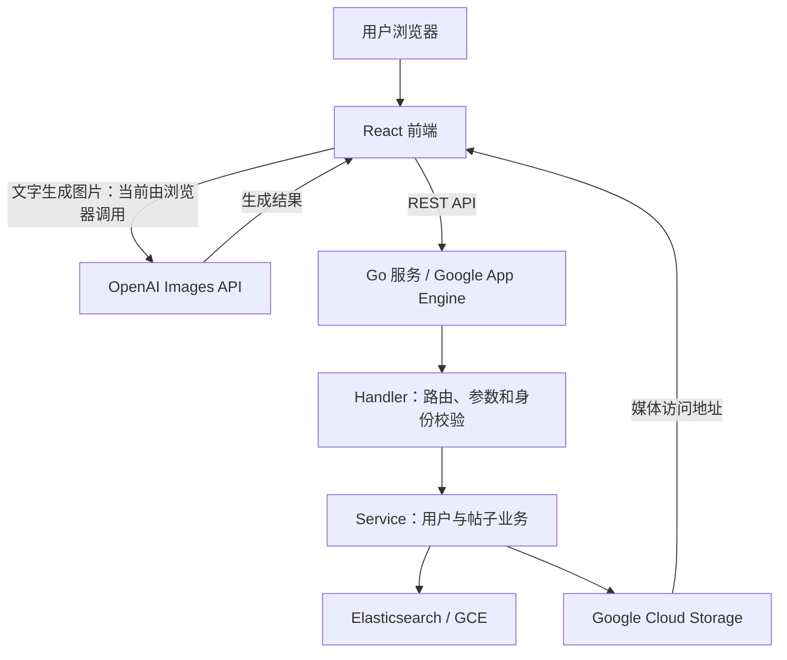
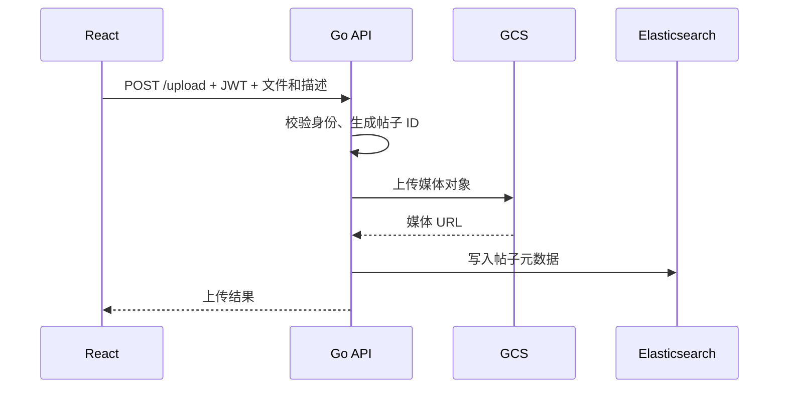

# Social AI 开发文档

## 1. 项目概述

Social AI 是一个结合 AI 图片创作与媒体分享的全栈 Web 应用。用户可以注册和登录，通过文字描述请求生成图片，预览生成结果并发布为帖子；也可以上传本地图片或视频，在内容库中浏览媒体，并按关键词或作者查找帖子。

项目采用 React 前端与 Go REST 服务分离的架构。Go 后端部署于 Google App Engine，Elasticsearch 安装在 Google Compute Engine（GCE）虚拟机上，用于用户和帖子数据存储及搜索；Google Cloud Storage（GCS）保存上传的媒体文件。

项目主要面向三个场景：

1. **AI 创作**：将文字描述转换成图片，连接预览和发布流程。
2. **媒体分享**：上传图片或视频，展示为可检索的帖子。
3. **内容发现与管理**：浏览共享内容库，按关键词或作者检索，并删除自己发布的帖子。

当前 Collection 是共享内容库。按用户名查询用于查看某个作者的作品，不代表私人相册或账号之间的文件访问隔离。

## 2. 项目架构

### 2.1 系统结构



前端负责交互、路由和展示；后端负责身份验证、媒体上传、检索和删除。Elasticsearch 保存结构化数据，GCS 保存图片与视频。当前后端是分层组织的单个 Go 服务，不是微服务系统。

### 2.2 技术栈

| 模块 | 技术 | 作用 |
| --- | --- | --- |
| 前端 | React 18、Create React App | 组件开发、状态管理与构建 |
| 路由 | React Router v6 | 页面导航与登录访问控制 |
| UI | Material UI、Ant Design、styled-components | 导航、表单、上传弹窗与布局 |
| HTTP | Axios | 调用后端接口 |
| 图片展示 | react-photo-album、yet-another-react-lightbox | 相册、全屏、缩放、缩略图与幻灯片 |
| AI | OpenAI SDK、代码指定 GPT Image 2 | 文字生成图片请求 |
| 服务端 | Go、net/http、Gorilla Mux | REST API |
| 认证 | JWT HS256、JWT middleware | 签发和验证 token |
| 数据与搜索 | Elasticsearch、olivere/elastic v7 | 用户和帖子存储、全文及精确检索 |
| 媒体存储 | Google Cloud Storage | 保存图片与视频 |
| 云部署 | Google App Engine、Google Compute Engine | Go 服务托管、Elasticsearch 运行 |

## 3. 前端设计与实现

### 3.1 页面与组件

| 页面 / 组件 | 职责 |
| --- | --- |
| App | 维护登录状态，保存和清除 token |
| Main | 定义路由和未登录跳转 |
| ResponsiveAppBar | Create、Collection 导航和退出按钮 |
| Login / Register | 登录注册表单、校验和接口请求 |
| Landing | AI 描述输入、生成状态、预览及发布 |
| Collection | 内容加载、搜索条件、图片 / 视频标签页 |
| SearchBar | All、Keyword、User 查询模式 |
| CreatePostButton / PostForm | 创建帖子弹窗、文字和文件选择 |
| PhotoGallery | 相册、大图预览和图片删除操作 |

### 3.2 登录注册与路由控制

注册表单要求用户名、密码和确认密码，前端验证必填项和密码一致性，再调用 `/signup`。注册接口本身不需要 token。

登录成功后，`/signin` 返回纯文本 JWT。前端将其保存在 localStorage 的 `token` 项中，并更新登录状态。上传、搜索和删除请求通过 `Authorization: Bearer <token>` 携带凭证。退出登录清除本地 token。

| 路径 | 页面 | 访问行为 |
| --- | --- | --- |
| `/`、`/login` | 登录 | 已登录时跳转 `/create` |
| `/register` | 注册 | 已登录时跳转 `/create` |
| `/create` | AI 创作 | 未登录时跳转 `/login` |
| `/collection` | 内容库 | 未登录时跳转 `/login` |

前端路由控制提供页面访问体验，实际业务权限由服务端验证。当前前端仅依据 token 是否存在恢复登录状态，因此 token 过期时仍可能显示已登录，接口随后返回 401。

### 3.3 AI 图片生成与帖子发布

`Landing.js` 使用 OpenAI SDK 发起文字生成图片请求。当前代码指定 `gpt-image-2`，每次生成一张图片，尺寸参数为 `1024x1024`。

流程如下：

1. 检查描述非空，防止生成中重复提交。
2. 设置加载状态并发送生成请求。
3. 从 `data[0].b64_json` 读取结果，构造 PNG Data URL。
4. 在相册中展示生成图片，支持打开大图查看。
5. 用户点击上传按钮，前端将图片转换为文件，通过 `/upload` 发布。

当前发布生成图片时，文字说明固定为 `AI generated image`。项目实现的是生成新图片和创建帖子，尚未实现编辑或更新已有帖子的功能。

接口异常会显示错误信息，并在 finally 中恢复生成状态。调试中已观察到 `moderation_blocked` 响应，因此“已接入生成 API”与“成功生成路径已验收”需要分别记录。本文不将未经确认的成功路径标记为通过。

### 3.4 本地媒体上传

用户在 Collection 中点击 Create New Post，填写 Message 并选择文件。前端提交 multipart/form-data：

- `message`：帖子描述。
- `media_file`：所选媒体文件。

当前表单处理第一个选中文件，上传成功后触发内容库刷新。图片与视频根据帖子 `type` 显示在不同标签页。

### 3.5 内容库与相册

Collection 的默认 All 模式请求共享帖子列表。图片以相册形式展示，视频通过 HTML video 控件播放。

图片预览配置全屏、缩放、缩略图和幻灯片功能。相册对象使用帖子 ID 作为稳定 key，避免多个帖子使用相同 URL 时产生 React 重复 key 警告。

当前不存在 My Collection 独立页面。User 模式通过输入用户名查看该作者帖子。

## 4. 后端设计与实现

### 4.1 分层结构

| 层级 | 目录 | 职责 |
| --- | --- | --- |
| 入口 | main.go | 加载配置、初始化依赖、启动 HTTP 服务 |
| 请求层 | handler/ | 注册路由、解析请求、获取 JWT 身份、返回响应 |
| 业务层 | service/ | 用户验证、帖子上传编排、查询和删除条件 |
| 存储层 | backend/ | Elasticsearch 与 GCS SDK 调用 |
| 数据模型 | model/ | User 与 Post |
| 配置辅助 | util/、conf/ | YAML 配置结构和加载 |

后端代码监听 `:8080`。Go 服务的云端部署与本地源码可构建性需要分别验证，不能因云端已有运行版本就认定本地副本没有问题。

### 4.2 JWT 身份认证

登录接口验证用户名、密码后，签发包含 `username` 和 `exp` 的 HS256 JWT，代码中的有效期为 24 小时。

`/upload`、`/search`、`/post/{id}` 由 JWT 中间件保护；`/signup` 和 `/signin` 为公开入口。上传和删除从已验证 token 中读取用户名，而不是依赖客户端传入的作者字段。

当前退出登录属于客户端清除凭证，没有服务端 token 撤销机制。

### 4.3 媒体上传与存储

后端为帖子生成 UUID，通过扩展名识别媒体类型，将文件写入 GCS，取得媒体 URL 后把帖子元数据保存到 Elasticsearch。



GCS 实现尝试设置对象为公开读取。数据库和文件存储之间没有事务或失败补偿；如果索引写入失败，已上传对象可能残留。

### 4.4 Elasticsearch 搜索

Elasticsearch 部署在 GCE 虚拟机，项目使用 `user`、`post` 两个索引。已通过虚拟机 SSH 查询到帖子记录，确认其实际运行位置。

搜索实现包括：

- **作者搜索**：对 `user` 执行 TermQuery。
- **关键词搜索**：对 `message` 执行 MatchQuery，使用 AND 运算。
- **All**：空关键词时使用 ZeroTermsQuery 的 all 行为。

当 user 查询参数非空时，后端优先执行作者搜索。当前没有时间字段、按时间排序或时间范围过滤，因此不将其描述为“搜索最新帖子”。当前没有分页，All 也不保证一次返回全部数据库记录。

### 4.5 帖子删除

后端使用帖子 `id` 与 JWT 用户名组合查询，限制删除属于当前用户的记录。前端收到成功响应后移除当前相册项。

已确认的限制：当前存储层未检查实际删除数量，可能在零匹配时仍返回成功；前端因此会出现暂时消失、刷新后重新出现的情况。后续应返回明确删除结果，并刷新列表验证。

删除当前只针对 Elasticsearch 帖子记录，不包含 GCS 对象清理。

## 5. 数据模型与 API

### 5.1 数据模型

| 模型 | 字段 | 说明 |
| --- | --- | --- |
| User | username、password、age、gender | 用户名与密码参与当前认证；年龄和性别为模型预留 |
| Post | id、user、message、url、type | 帖子标识、发布者、描述、媒体 URL 和类型 |

帖子 `id`、`user` 映射为 keyword，`message` 为 text。当前没有点赞、评论、关注或创建时间等字段。

### 5.2 REST API

| 方法 | 路径 | 输入 | 成功响应 | JWT |
| --- | --- | --- | --- | --- |
| POST | `/signup` | JSON：username、password | 200，空正文 | 否 |
| POST | `/signin` | JSON：username、password | 200，纯文本 token | 否 |
| POST | `/upload` | multipart：message、media_file | 200，空正文 | 是 |
| GET | `/search` | 可选 user、keywords 参数 | 200，帖子 JSON | 是 |
| DELETE | `/post/{id}` | 帖子 ID | 200，空正文 | 是 |

当前错误多以纯文本返回。无搜索结果可能返回 null，建议后续统一为数组及一致的错误结构。没有 PUT/PATCH 编辑帖子接口。

## 6. 目录结构与开发环境

```text
socialai/
├── frontend/social-ai/
│   ├── package.json / package-lock.json
│   ├── public/
│   └── src/
│       ├── components/
│       ├── styles/
│       ├── constants.js
│       └── index.js
└── backend/socialai/
    ├── main.go
    ├── go.mod / go.sum
    ├── app.yaml
    ├── handler/
    ├── service/
    ├── backend/
    ├── model/
    ├── constants/
    ├── util/
    └── conf/
```

### 6.1 前端运行

```bash
cd frontend/social-ai
npm ci
npm start
```

默认开发地址为 `http://localhost:3000`。`src/constants.js` 的 BASE_URL 指向 Go API；若使用本地后端，则配置为对应的本地服务地址。

当前代码读取前端根目录 `.env` 的 `REACT_APP_OPENAI_KEY`。这只是现有实现方式，不能将浏览器构建变量视为保密存储。正式上线应通过后端调用 OpenAI。

### 6.2 后端配置与运行

后端需要可连接的 Elasticsearch、可用的 GCS bucket 和 Google Cloud 运行凭证。`conf/deploy.yml` 的结构如下，所有值均为占位符：

```yaml
elasticsearch:
  address: "<ELASTICSEARCH_URL>"
  username: "<ELASTICSEARCH_USERNAME>"
  password: "<ELASTICSEARCH_PASSWORD>"
gcs:
  bucket: "<GCS_BUCKET>"
token:
  secret: "<JWT_SIGNING_SECRET>"
```

在修复本地构建问题、准备依赖及凭证后，执行：

```bash
cd backend/socialai
go mod download
go build ./...
go run .
```

Go 工具链应与 go.mod 要求相匹配。GCS 使用运行环境凭证，实际身份必须具备所需存储权限。Elasticsearch 若仅使用 GCE 内网地址，本地开发还需确认网络可达性。

## 7. 部署说明

### 7.1 当前部署结构

- Go API：Google App Engine；开发中前端调用其 appspot.com 地址。
- Elasticsearch：Google Compute Engine 虚拟机，已通过 SSH 查询确认。
- 媒体：通过 GCS SDK 上传到配置 bucket。
- React 前端：已有 localhost 运行记录；没有确认 AWS Amplify 生产部署已完成。

### 7.2 前端可选云部署

若使用 AWS Amplify 托管前端，仓库应用目录为 `frontend/social-ai`，构建命令为 `npm run build`，产物目录为 `build`。应配置 SPA 路由重写，并确认后端 HTTPS 地址与 CORS 允许来源。

前端托管不要求把已有 Go 服务和 Elasticsearch 一起迁到 AWS。生产上线前，应完成服务端 AI 调用迁移、密钥清理和认证失效处理。修改这些内容后需要重新构建或部署相应服务。

## 8. 调试记录与已知限制

| 问题 | 已确认原因 / 当前处理方向 |
| --- | --- |
| Collection 返回 401 | token 无效或过期时服务端拒绝请求；前端存在 token 不等于认证有效 |
| 相册重复 key | 原先以 URL 作为默认 key；已检查代码使用 postId 作为 key |
| 两条图片显示失败 | search 返回的网站首页 URL 不是图片文件；已通过 ES 查询确认测试记录属于 sun、zhao |
| 删除后刷新重新出现 | 后端零匹配也可能返回成功，前端只按 200 隐藏图片 |
| AI 返回 400 | 已观察到 moderation_blocked；不应笼统归因为参数或密钥错误 |
| 无法更新已有帖子 | 当前没有编辑接口，不属于已实现能力 |

错误测试帖子的 Elasticsearch 文档 ID 已查询确认为 1、2，并已提供单文档删除命令；本文未收到最终删除结果，不将清理标记为已完成。

### 8.1 本地源码与生产化改进

- 本地 `main.go` 的 Elasticsearch 初始化调用与函数声明参数不一致，相关文件存在未使用导入；需要先修复再构建。
- 源码中存在硬编码数据库凭证，应迁移到配置或密钥管理，并排除真实配置。仅忽略 YAML 不足以保护写在 Go 源码里的密码。
- 当前密码直接存储和匹配，需改用密码哈希，删除打印登录注册表单值的日志。
- OpenAI key 当前由浏览器使用，需迁移服务端，并加入配额和请求限制。
- 注册用户名校验逻辑需要修正；文件上传需校验大小、实际类型并正确关闭句柄。
- AI 图片按 PNG 构造，但上传文件名和 MIME 声明为 JPG，需统一。
- 表单失败分支需恢复加载状态；完善空结果、图片加载失败和无权限提示。
- 增加搜索分页、排序和存储失败补偿，收紧 CORS 来源。

以上属于改进事项，不作为简历中已经实现的安全性、可扩展性或性能成果。

## 9. 测试与验收计划

| 测试模块 | 核心检查 |
| --- | --- |
| 账号 | 注册、重复用户、错误密码、退出和过期 token |
| 上传 | 图片 / 视频、无文件、非法格式、超限、存储失败 |
| AI | 空输入、生成成功路径、审核拒绝、网络异常与加载恢复 |
| 内容库 | 关键词、作者、空结果、重复 URL、失效图片 |
| 删除 | 自己帖子、其他作者帖子、不存在的 ID、刷新后结果 |
| 构建 | 前端 npm run build；后端 go build ./... |
| 部署 | 线上路由刷新、跨域、后端连接、媒体访问和凭证配置 |

本次文档整理没有运行自动测试、构建或云部署。没有压测数据支撑“高并发”“高可用”或“可扩展性已验证”等结论。

## 10. 与简历描述的对应关系

| 简历主题 | 文档对应 | 准确表述边界 |
| --- | --- | --- |
| React 社交应用 | 第 1、3 节 | 媒体分享与搜索，不扩展为完整社交网络功能 |
| GPT Image 2 | 第 3.3 节 | 生成 API 集成与发布；不宣称编辑帖子或未确认的生成验收 |
| 认证与路由 | 第 3.2、4.2 节 | React Router v6；注册与 JWT 登录分别描述 |
| Go 云服务 | 第 4、7 节 | REST 服务及 GAE 部署，不附加未验证性能结论 |
| Elasticsearch / GCE | 第 4.4 节 | 关键词与作者搜索，无最新排序或私人隔离 |
| GCS 媒体存储 | 第 4.3 节 | 文件存储与帖子元数据分离 |

推荐项目概述：使用 React 和 Go 开发 AI 媒体分享应用，集成 OpenAI 图片生成请求，实现 JWT 登录、媒体上传、相册浏览、关键词与作者搜索及作者范围内的删除逻辑；采用 Elasticsearch 和 GCS 分别存储帖子数据与媒体文件，后端部署于 Google App Engine，Elasticsearch 运行在 GCE。
